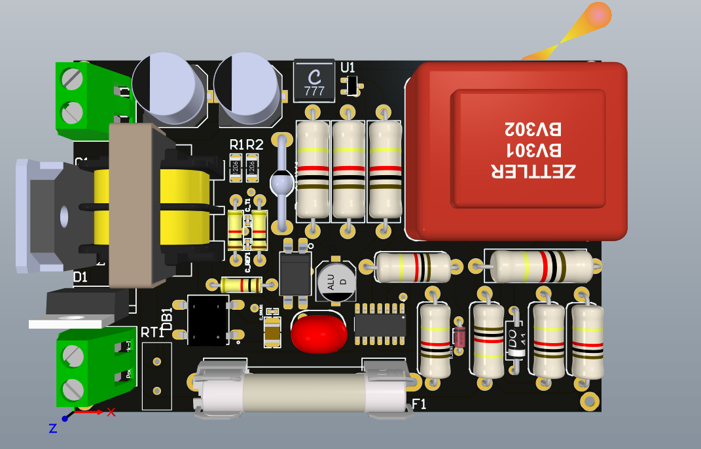
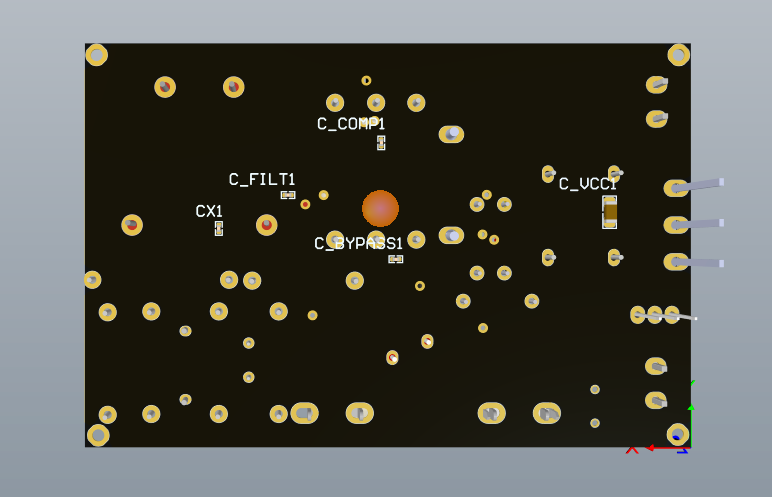

# ⚡ Isolated AC-DC Flyback Converter (12V Regulated Output)

[](https://www.altium.com/)
[]()
[](https://www.ti.com/product/UC3843A)
[]()
[]()
[](LICENSE)

An industrial-grade, galvanically isolated offline **AC-DC Flyback Converter** designed in **Altium Designer**. This switch-mode power supply (SMPS) steps down universal mains AC voltage (85V – 265V AC, 50/60 Hz) to a tightly regulated **+12V DC** output with low ripple, robust input EMI filtering, cycle-by-cycle current limiting, primary RCD snubber protection, and optocoupler-isolated feedback.

> 🇮🇷 **معرفی پروژه به زبان فارسی:**
> این پروژه شامل طراحی کامل برد منبع تغذیه سوئیچینگ ایزوله از نوع **فلای‌بک (Flyback Converter)** با ورودی برق شهر (AC) و خروجی رگوله‌شده‌ی **12 ولت DC** در نرم‌افزار **Altium Designer** می‌باشد. در این طراحی از کنترلر مد جریان **UC3843A**، ترانزیستور قدرت ماسفت 650 ولتی **APT94N65**، سیستم فیدبک ایزوله با اپتوکوپلر **EL817** و رفرنس ولتاژ **TL431**، مدار فیلتر ورودی کامل EMI و مدار اسنابر RCD استفاده شده است.

---

## 📸 3D PCB Visualization

<div align="center">
  
  <p><em>Figure 1: 3D Render - Component Placement (Top Layer)</em></p>
</div>

<br/>

<div align="center">
  
  <p><em>Figure 2: 3D Render - SMT Components & Bottom Copper Pour</em></p>
</div>

---

## 📋 Key Technical Specifications

| Parameter | Specification | Description / Notes |
| :--- | :--- | :--- |
| **Topology** | Isolated Current-Mode Flyback | Single-ended discontinuous / continuous conduction |
| **Input Voltage Range** | $85\text{ V} - 265\text{ V AC}$ ($50/60\text{ Hz}$) | Universal mains input or up to $375\text{ V DC}$ bus |
| **Nominal Input** | $220\text{ V AC}$ | Standard line voltage |
| **Output Voltage** | **$+12.0\text{ V DC}$** | Closed-loop regulated via TL431 |
| **PWM Controller** | **TI UC3843ADG4** | Current-Mode PWM controller (SOIC-14 package) |
| **Switching Frequency** | $\approx 100\text{ kHz}$ | Programmed via precision $R_T$ / $C_T$ oscillator network |
| **Primary Power Switch** | **APT94N65** | N-Channel Power MOSFET ($650\text{ V}$, $94\text{ A}$, TO-247) |
| **Secondary Rectifier** | **MBR20100** | High-efficiency Dual Schottky Diode ($100\text{ V}$, $20\text{ A}$, TO-220) |
| **Output Filter** | **CLC $\pi$-Filter** | Dual $470\,\mu\text{F} / 35\text{V}$ low-ESR caps + $2.2\,\mu\text{H}$ power inductor |
| **Feedback Loop** | Isolated Type-II | **EL817** Optocoupler + **TL431** Precision reference |
| **Safety Isolation** | **$> 6.5\text{ mm}$ creepage & clearance** | Primary to secondary galvanic isolation barrier |
| **PCB Dimensions** | $90.0\text{ mm} \times 60.0\text{ mm}$ ($3.54" \times 2.36"$) | Compact 2-layer FR-4 form factor |
| **Copper Weight** | $1\text{ oz}$ ($35\,\mu\text{m}$) | Heavy power traces for thermal handling |

---

## 🧩 System Architecture & Block Diagram

```mermaid
flowchart LR
    subgraph AC_Input_Stage ["1. Input & Protection"]
        AC["AC Line / Neutral<br/>(85-265V AC)"] --> FUSE["Fuse (F1)<br/>30A / 5x20mm"]
        FUSE --> NTC["Inrush NTC (RT1)<br/>B57236 (5Ω, 4.5A)"]
        NTC --> MOV["Surge MOV (VR1)<br/>Varistor Protection"]
        MOV --> EMI["EMI Filter<br/>UU16 CM Choke + X-Cap"]
    end

    subgraph Primary_Stage ["2. Primary Power & Control"]
        EMI --> BR["Bridge Rectifier (DB1)<br/>MB10 (SMD)"]
        BR --> DC_BUS["High-Voltage DC Bus<br/>(~310V DC)"]
        DC_BUS --> XFRM["Flyback Transformer<br/>(T1 - 2P2S Core)"]
        XFRM --> SNUB["RCD Snubber<br/>1N4002 + 2.2nF + Resistor"]
        XFRM --> Q1["Primary MOSFET<br/>APT94N65 (650V)"]
        Q1 --> RSENSE["Current Shunt (R_SENSE)<br/>+ RC Filter to ISENSE"]
        
        PWM["PWM Controller<br/>UC3843A (SOIC-14)"] -->|Gate Drive| Q1
        RSENSE -->|Peak Current Sense| PWM
        DC_BUS -->|Start-up Resistors| PWM
        XFRM -->|Auxiliary Bias (D_AUX)| PWM
    end

    subgraph Secondary_Stage ["3. Secondary Rectification & Filter"]
        XFRM -->|Isolated Secondary| RECT["Schottky Rectifier<br/>MBR20100 (20A, 100V)"]
        RECT --> PI_FILTER["CLC Pi-Filter<br/>C_OUT1 + L_POST + C_OUT2"]
        PI_FILTER --> DC_OUT["Regulated Output<br/>+12V DC Terminal"]
    end

    subgraph Feedback_Loop ["4. Isolated Feedback Regulation"]
        DC_OUT --> V_DIV["Resistor Divider<br/>R_TOP / R_BOT"]
        V_DIV --> TL431["Precision Shunt Ref<br/>TL431 (2.5V Ref)"]
        TL431 --> OPTO["Optocoupler<br/>EL817"]
        OPTO -. Galvanic Barrier .->|COMP Feedback| PWM
    end

    classDef primary fill:#2d3748,stroke:#cbd5e0,stroke-width:1px,color:#fff;
    classDef secondary fill:#1a365d,stroke:#63b3ed,stroke-width:1px,color:#fff;
    classDef safety fill:#742a2a,stroke:#feb2b2,stroke-width:1px,color:#fff;
    classDef control fill:#234e52,stroke:#81e6d9,stroke-width:1px,color:#fff;

    class AC,FUSE,NTC,MOV,EMI safety;
    class BR,DC_BUS,XFRM,SNUB,Q1,RSENSE primary;
    class PWM control;
    class RECT,PI_FILTER,DC_OUT secondary;
    class V_DIV,TL431,OPTO control;
```

---

## 🔍 Functional Circuit Blocks

### 1. Mains AC Input & EMI Filter
* **Overcurrent Protection**: Input cartridge fuse ($F_1$) protects against catastrophic short-circuit conditions.
* **Inrush Current Suppression**: Negative Temperature Coefficient (NTC) thermistor ($RT_1$: `B57236S0509M000`, $5\,\Omega$, $4.5\,\text{A}$) limits capacitor inrush currents during cold start.
* **Surge Suppression**: Metal Oxide Varistor ($VR_1$) clamps line transients and surge events.
* **Common-Mode EMI Choke**: Coupled inductor ($T_2$: `UU16` core) suppresses conducted electromagnetic interference back into the mains network.
* **X-Safety Capacitor**: Across-the-line film capacitor ($CX_1$) with bleeding resistors ($R_1, R_2$) ensures regulatory compliance and shock safety when unplugged.

### 2. Primary Power Stage & Clamping Snubber
* **Bridge Rectification**: Full-wave SMD bridge rectifier ($DB_1$: `MB10`) provides clean DC bus potential ($\approx 310\,\text{V DC}$).
* **RCD Snubber Network**: Diode $D_{\text{SNUB}1}$ (`1N4002`), capacitor $C_{\text{SNUB}1}$ ($2.2\,\text{nF}$), and damping resistor $R_{\text{SNUB}1}$ suppress high-voltage inductive spikes caused by transformer leakage inductance at MOSFET turn-off, preserving switch integrity.
* **Power MOSFET**: High-voltage N-channel MOSFET ($Q_1$: `APT94N65`, $V_{\text{DS}} = 650\,\text{V}$) handles primary switching pulses with low conduction losses.

### 3. Current-Mode PWM Controller (UC3843A)
* **Oscillator Configuration**: Pin 7 ($R_T/C_T$) is driven by a precision timing network ($R_{T1}$, $C_{T1}$) configuring high-frequency switching ($\approx 100\,\text{kHz}$).
* **Current Sensing**: Shunt resistor $R_{\text{SENSE}1}$ monitors primary current. A dedicated RC low-pass filter ($R_{\text{FILT}1}$, $C_{\text{FILT}1}$) filters leading-edge turn-on spikes before feeding the `ISENSE` input (Pin 5) for cycle-by-cycle peak current protection.
* **Gate Drive Circuitry**: Fast turn-on via series gate resistor $R_{G1}$, coupled with anti-parallel fast diode $D_{\text{DIS}1}$ (`1N4148`) and pull-down resistor $R_{\text{PD}1}$ to eliminate parasitic gate-source ringing and guarantee swift turn-off.
* **Auxiliary Power Supply**: Startup resistors ($R_{\text{START}1}, R_{\text{START}2}$) trickle-charge $C_{\text{VCC}1}$ until the controller enters run mode, after which an auxiliary transformer winding ($D_{\text{AUX}1}$, $C_{\text{AUX}1}$) sustains controller power continuously.

### 4. Secondary Rectification & CLC Post-Filter
* **Schottky Barrier Diode**: Dual Schottky rectifier $D_1$ (`MBR20100`, $100\,\text{V}$, $20\,\text{A}$) provides ultra-fast recovery and low forward voltage drop, maximizing efficiency.
* **$\pi$-Filter (CLC Stage)**: Consists of dual high-capacitance filter capacitors ($C_{\text{OUT}1}, C_{\text{OUT}2}$: $470\,\mu\text{F} / 35\,\text{V}$) paired with power inductor $L_{\text{POST}1}$ ($2.2\,\mu\text{H}$, $3.75\,\text{A}$), drastically reducing switching frequency voltage ripple and high-frequency noise spikes.

### 5. Precision Galvanic Feedback Loop
* **Voltage Sense & Reference**: Output voltage is sampled through a precision resistor divider ($R_{\text{TOP}1}, R_{\text{BOT}1}$) and compared against internal $2.5\,\text{V}$ reference inside the `TL431` adjustable shunt regulator ($U_1$).
* **Optocoupler Isolation**: The error current drives the LED of optocoupler $U_2$ (`EL817`), whose phototransistor modulates the `COMP` pin of the primary `UC3843A` controller.
* **Compensation**: Type-II loop compensation network ($R_{\text{COMP}1}, C_{\text{COMP}1}$) shapes the frequency response for unconditional phase margin and rapid transient response.

---

## 📐 PCB Layout & Safety Design

* **Board Dimensions**: $90.0\,\text{mm} \times 60.0\,\text{mm}$ ($3543 \times 2362\,\text{mils}$)
* **Layer Count**: 2 Layers (`Top Layer` & `Bottom Layer`)
* **Galvanic Isolation Barrier**: A strict **$6.5\,\text{mm}$ minimum clearance and creepage distance** is maintained between high-voltage primary nets (`AC_L`, `AC_N`, `DC_BUS`, `PRI_GND`) and secondary low-voltage nets (`+12V_OUT`, `SEC_GND`).
* **Power Trace Sizing**:
  * High-current paths (`DC_BUS`, `PRI_GND`, `SEC_GND`, `+12V_OUT`, `Drain`) are routed with wide traces ($0.8\,\text{mm} - 2.0\,\text{mm}$, with preferred width $1.2\,\text{mm}$) and dedicated polygon pours to withstand switching currents.
  * Small-signal tracks are routed at standard $0.254\,\text{mm}$ ($10\,\text{mil}$) width.
* **Thermal Management**: Generous thermal copper pours and pads on both layers dissipate heat from the primary switch ($Q_1$), secondary rectifier ($D_1$), and transformer core ($T_1$).

---

## 📦 Bill of Materials (BOM)

| Designator | Component Name / Part Number | Description | Footprint / Package |
| :--- | :--- | :--- | :--- |
| **$U_3$** | **UC3843ADG4** | 30V, 500kHz Current-Mode PWM Controller | SOIC-14 |
| **$U_1$** | **TL431** | Precision Programmable Voltage Reference | SOT-23-3 |
| **$U_2$** | **EL817** | 4-Pin Phototransistor Optocoupler | SMD-4 / SOP-4 |
| **$Q_1$** | **APT94N65** | N-Ch Power MOSFET, $650\text{V}$, $94\text{A}$, $300\,\text{m}\Omega$ | TO-247 |
| **$D_1$** | **MBR20100** | Dual Schottky Barrier Diode, $100\text{V}$, $20\text{A}$ | TO-220AB |
| **$D_{\text{SNUB}1}$**| **1N4002** | General Purpose Rectifier Diode, $100\text{V} / 1\text{A}$ | DO-41 / Axial |
| **$D_{\text{DIS}1}$** | **1N4148** | Ultra-Fast Switching Diode | DO-35 |
| **$D_{\text{AUX}1}$** | **BYW172** | Fast Recovery Rectifier Diode | Axial |
| **$DB_1$** | **MB10** | Single-Phase Bridge Rectifier | SMD Bridge |
| **$T_1$** | **Flyback Transformer** | Custom 2-Primary / 2-Secondary E-Core (220:9) | Through-Hole 8-Pin |
| **$T_2$** | **Common Mode Choke** | UU16 Common-Mode Line Filter Choke | UU16 / Through-Hole |
| **$L_{\text{POST}1}$**| **$2.2\,\mu\text{H}$ Inductor** | Power Inductor, $3.75\text{A}$ Irms, $20\,\text{m}\Omega$ | SMD Power Inductor |
| **$F_1$** | **$30\text{A}$ Fuse** | Cartridge Fuse Holder ($5 \times 20\,\text{mm}$) | Through-Hole Clip |
| **$RT_1$** | **B57236S0509M000** | Inrush Current Limiting NTC ($5\,\Omega, 4.5\,\text{A}$) | Radial Disc $11.5\,\text{mm}$ |
| **$VR_1$** | **MOV-07D / B72207S011** | Metal Oxide Varistor Surge Suppressor | Radial Disc $7\,\text{mm}$ |
| **$C_{\text{OUT}1}, C_{\text{OUT}2}$** | **$470\,\mu\text{F} / 35\text{V}$** | Low-ESR Aluminum Electrolytic Capacitor | SMD Cylindrical Can |
| **$C_{\text{AUX}1}$**| **$22\,\mu\text{F} / 50\text{V}$** | Auxiliary Supply Electrolytic Capacitor | SMD Cylindrical Can |
| **$C_{\text{VCC}1}$**| **$22\,\mu\text{F} / 35\text{V}$** | MLCC Decoupling Capacitor | 1206 SMD |
| **$C_{\text{BULK}1}$**| **$68\,\text{nF} / 1\text{kV}$** | High-Voltage Ceramic Filter Capacitor | 1210 SMD |
| **$CX_1$** | **$100\,\text{nF} / 50\text{V}$** | X-Filter Ceramic Capacitor | 0402 SMD |
| **$C_{\text{REF}1}, C_{\text{BYPASS}1}$** | **$100\,\text{nF}$** | Noise Bypass Ceramic Capacitors | 0402 SMD |
| **$C_{\text{SNUB}1}, C_{T1}$** | **$2.2\,\text{nF} / 50\text{V}$** | Snubber & Timing Capacitors | 0805 / 1206 SMD |
| **$C_{\text{FILT}1}$**| **$470\,\text{pF} / 50\text{V}$** | Current Sense Noise Filter Capacitor (C0G) | 0402 SMD |
| **$C_{\text{COMP}1}$**| **$100\,\text{nF} / 35\text{V}$** | Feedback Compensation Capacitor | 0402 SMD |
| **$\text{PowerJack-IN1}$** | **2-Pin Terminal Block** | AC Mains Input Terminal, $5.08\,\text{mm}$ pitch | Screw Terminal |
| **$J_{\text{OUT}1}$** | **2-Pin Terminal Block** | DC Output Terminal (+12V/GND), $5.08\,\text{mm}$ | Screw Terminal |

---

## 🗂️ Repository Directory Structure

```text
├── Flyback Converter.PrjPcb          # Main Altium Designer Project file
├── Flyback Converter.PrjPcbStructure  # Altium Project Structure metadata
├── Sheet1.SchDoc                     # Complete Hierarchical Schematic Sheet
├── PCB1.PcbDoc                       # 2-Layer PCB Layout & Routing
├── CAMtastic1.Cam / CAMtastic2.Cam   # CAM Verification Data
├── images/                           # High-Resolution 3D Board Renders
│   ├── pcb_3d_top.png                # Top View 3D Render
│   └── pcb_3d_bottom.png             # Bottom View 3D Render
├── Project Outputs for Flyback Converter/ # Manufacturing & Fabrication Files
│   ├── PCB1_Copper_Signal_Top.gbr    # Top Copper Gerber (RS-274X)
│   ├── PCB1_Copper_Signal_Bot.gbr    # Bottom Copper Gerber (RS-274X)
│   ├── PCB1_Soldermask_Top.gbr       # Top Solder Mask
│   ├── PCB1_Soldermask_Bot.gbr       # Bottom Solder Mask
│   ├── PCB1_Legend_Top.gbr           # Top Silkscreen / Overlay
│   ├── PCB1_Legend_Bot.gbr           # Bottom Silkscreen / Overlay
│   ├── PCB1_Paste_Top.gbr / Bot.gbr  # Solder Paste Stencil layers
│   ├── PCB1_Profile.gbr              # Board Outline & Routing profile
│   ├── PCB1_PTH_Drill.gbr            # Plated Through-Hole Drill Gerber
│   ├── PCB1_NPTH_Drill.gbr           # Non-Plated Through-Hole Drill Gerber
│   ├── PCB1-RoundHoles.TXT           # NC Drill File (Round Holes)
│   ├── PCB1-SlotHoles.TXT            # NC Drill File (Milled Slots)
│   └── Design Rule Check - PCB1.html # DRC Verification Report
├── .gitignore                        # Altium temporary/backup ignore rules
├── LICENSE                           # MIT License
└── README.md                         # Project Documentation
```

---

## 🚀 Manufacturing & Assembly Guidelines

### 1. Ordering PCBs
All required fabrication files are pre-generated in standard **RS-274X Gerber** and **Excellon NC Drill** formats inside the `Project Outputs for Flyback Converter/` directory:
- **Board Outline**: $90.0 \times 60.0\,\text{mm}$ (defined in `PCB1_Profile.gbr`)
- **Layers**: 2 Layers (FR-4)
- **Finished Copper Thickness**: $1\,\text{oz}$ ($35\,\mu\text{m}$) recommended
- **Solder Mask**: Black / Matte Black (as rendered) or Green
- **Silkscreen**: White
- **Surface Finish**: HASL Lead-Free or ENIG (Electroless Nickel Immersion Gold)
- **Minimum Trace / Space**: $10\,\text{mil} / 10\,\text{mil}$ ($0.254\,\text{mm}$)

### 2. Opening in Altium Designer
1. Clone this repository:
   ```bash
   git clone https://github.com/Mooch3384/Flyback-Converter.git
   ```
2. Open `Flyback Converter.PrjPcb` in **Altium Designer 20 / 21 / 22 / 23 / 24 / 25+**.
3. View or edit schematics via `Sheet1.SchDoc` and the PCB layout via `PCB1.PcbDoc`.

---

## ⚠️ High-Voltage Safety Warning

> [!WARNING]
> **LETHAL VOLTAGES ARE PRESENT ON THIS BOARD!**
> - The primary side of this circuit operates directly from rectified AC mains line voltage ($\approx 310\text{V DC}$).
> - Always connect the board through an **isolated safety transformer** and a current-limited source when testing, debugging, or probing with an oscilloscope.
> - Never connect non-isolated oscilloscope ground clips directly to the primary ground (`PRI_GND`), as this can destroy test equipment and presents severe electrical shock hazards.
> - Ensure bulk capacitors are fully discharged before handling the board.

---

## 📄 License & Credits

This project is open-source hardware licensed under the [MIT License](LICENSE).

Designed by **Amirhosein Moochani** ([@Mooch3384](https://github.com/Mooch3384)).
Contributions, bug reports, and suggestions are welcome!
